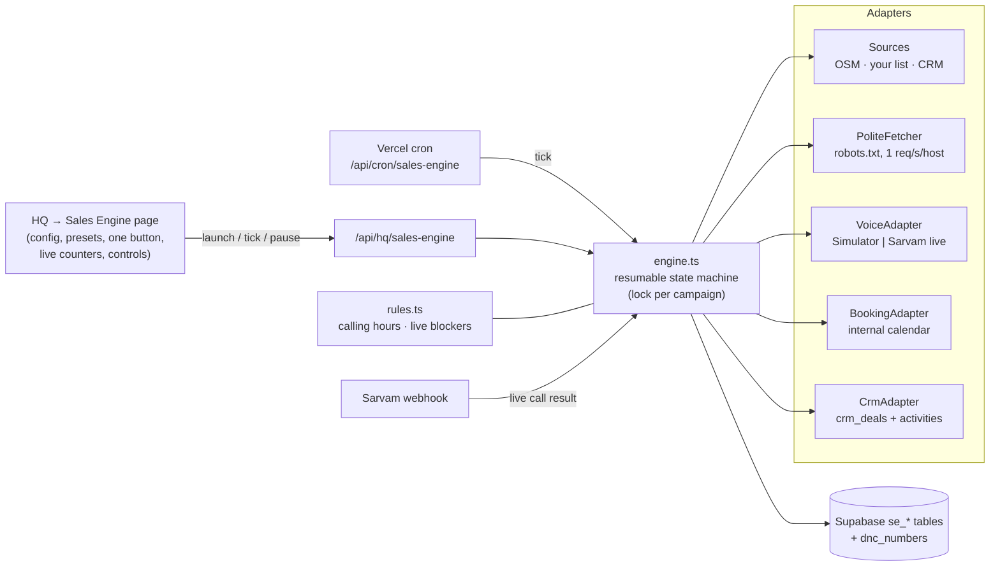

# RANA Sales Engine — one-click outbound (HQ → Sales Engine)

Configure a campaign, press **GENERATE & LAUNCH OUTBOUND CAMPAIGN**, and the engine discovers companies, researches their own websites, finds decision-makers, scores every lead with written reasons, checks do-not-contact lists, prepares an honest call plan (EN / HI / TE / Telugu-English), calls (simulated by default), books demos into genuinely free slots, writes outcomes to the Sales CRM and schedules follow-ups.

**Default = simulation.** No real phone is dialled and nothing paid is used unless live calling is deliberately switched on *and* every compliance check passes for that prospect.

---

## 1. Repository audit (17 Oct 2026, commit `d45c935`)

| Area | What exists | Reused? |
|---|---|---|
| Frontend / backend | Next.js 14 App Router on Vercel, API routes under `app/api`, Tailwind design tokens | Yes — new page + routes follow the same patterns |
| Database | Supabase via PostgREST (`lib/db.ts` `sb()`), service key server-side, no migrations folder (tables managed in Supabase) | Yes — new `se_*` tables in `supabase/migrations/` |
| Auth | HMAC session cookie (`middleware.ts`, `lib/session.ts`); HQ roles in `lib/hq.ts` (`requireHq`) | Yes — every Sales Engine route is HQ-only; launching needs the `clients` permission |
| AI models | `lib/llm.ts` → Anthropic / OpenAI / Sarvam chat keys (all billed per token) | **Not used** by the engine (cost) |
| Voice | Sarvam agents (`lib/sarvamAgent.ts`, rented Indian number, `placeOutboundCall`), Cartesia batches (`lib/cartesia.ts`, Twilio-imported numbers), ElevenLabs voice client | Sarvam outbound reused for the live adapter |
| Telephony | Sarvam connection (`RANA_SARVAM_CONNECTION_ID`), Cartesia/Twilio numbers | Live adapter only; every real call costs Sarvam credits |
| CRM | HQ Sales CRM: `crm_deals`, `crm_activities` (stages new → contacted → prospect → deal / not_interested), sheet sync, daily digest | Yes — engine writes outcomes there (source `ai_call`) |
| Compliance | `dnc_numbers` + EN/HI/TE opt-out phrase detection (`lib/compliance.ts`), legal calling windows per market | Yes — opt-outs join `dnc_numbers`; phrase detector reused |
| Booking | None (demo requests only have a status) | New internal demo calendar |
| Lead upload | `lib/leadImport.ts`, CRM import from Excel/CSV/Google Sheet | CRM leads usable as a campaign source |
| Workers / scheduling | Vercel crons (`vercel.json`), `cron_runs` log | New daily cron + dashboard-driven ticks |
| Inbound | `/talk` Talk-to-Rana, `/landing` with Book-a-demo + proof run, `/industries`, `/for/*`, SEO pages, UTM capture | Already strong — see §9 |

## 2. Open-source tools — verified licences and costs

Researched 17 Oct 2026 (licence files, official docs, model cards). "Unverified" = couldn't confirm from the primary source.

| Category | Option | Licence | Self-host / needs | Verdict for RANA |
|---|---|---|---|---|
| Workflow | n8n CE | Sustainable Use License (fair-code, internal use only) | 1–2 vCPU, 2 GB | Not needed; licence blocks reselling |
| Workflow | Activepieces | MIT core (EE folders commercial) | 2 vCPU, Postgres+Redis | Not needed |
| Workflow | Node-RED | Apache-2.0 | <512 MB | Too low-level |
| Workflow | Windmill | AGPLv3 core | 2 vCPU, 4 GB | Not needed |
| Workflow | Inngest | Server SSPL → Apache after 3 yrs | Single process | Best Vercel fit if the in-repo engine outgrows crons |
| Workflow | Trigger.dev v4 | Apache-2.0 | Heavy self-host (≥7 vCPU total) | Later, for browser workers |
| Agents | LangGraph.js | MIT | Library | Not needed — engine is a deterministic state machine |
| Agents | CrewAI / AutoGen → MS Agent Framework | MIT | Python/.NET | Skip (no TS; AutoGen in maintenance) |
| Browser | Playwright | Apache-2.0 | ~1 GB RAM/Chromium; won't run in Vercel functions | Not needed — plain HTTP reads company sites |
| Browser | browser-use | MIT | LLM tokens per step | Skip (cost) |
| Search | SearXNG | AGPL-3.0 | Docker, <512 MB | Optional future source (needs a server) |
| Extraction | Mozilla Readability / Crawlee | Apache-2.0 | Library | Not needed for v1 |
| Data | OpenStreetMap Overpass | Data ODbL; public API fair-use (identify UA, back off on 429) | Free | **Used** — one query per campaign |
| CRM | Twenty / EspoCRM / SuiteCRM | AGPLv3 (+ EE parts) | 1–2 GB servers | Not needed — RANA's CRM already exists |
| Local LLM | Ollama / llama.cpp | MIT | 8 GB RAM for 7–8B Q4; can't run on Vercel | Not needed (templates instead of AI copy) |
| STT | Whisper / faster-whisper; AI4Bharat IndicConformer | MIT / MIT (gated) | GPU for real time | Future self-hosted voice stack |
| TTS | Indic Parler-TTS (Apache-2.0), IndicF5 (MIT, voice-consent clause), Piper (GPL-3.0 engine) | — | GPU | Future; **avoid Coqui XTTS-v2 (non-commercial CPML)** |
| Calendar | Cal.com | Production code went private Apr 2026; public "Cal.diy" MIT, non-production | — | Not used |
| Calendar | Google Calendar API | Free quota (Google says overage billing coming later in 2026) | — | Possible adapter later |

**Selected (smallest reliable set):** the existing Next.js app + Supabase + Vercel crons, OpenStreetMap, plain HTTP, existing Sarvam integration (live only), existing Sales CRM. **Nothing new is installed in production.** `vitest` (MIT) was added as a dev-only test runner.

## 3. Architecture

Pipeline per campaign: **discover → research → score & check → prepare → call → book / follow up → done.** Each step saves before the next starts. An attempt is recorded *before* dialling, so a crash can never cause a second call; prospects stuck mid-call are recovered as "awaiting outcome" (live) rather than re-dialled.

## 4. What each step does

- **Discovery** (`sources.ts`): OpenStreetMap by industry tags in the chosen city (only places with a website or phone), your pasted list, or uncalled CRM leads. Deduped by domain → phone → name+city; companies already in another campaign are skipped.
- **Research** (`research.ts`, `extract.ts`): reads the home page + up to 4 contact/about/team pages. Honours robots.txt, never logs in or passes a CAPTCHA, honest user-agent, 1 request/second/host. Extracts phones (tel: links or numbers written next to a phone word), emails, schema.org people, "Name, Title" lines, and call-handling signals (site visits, admissions, appointments, enquiry forms, helplines, branches, hiring). Every fact stores its page URL and time.
- **Decision-makers**: a person counts only if their name and title are written on the company's own site (or your list, marked unverified). Phone types: `direct` (published against the person), `mobile` (public Indian mobile), `general` (company line — usually reception), `unverified` (from your list). No number is ever guessed.
- **Scoring** (`scoring.ts`): 0–100 across industry fit (20), evidence of the problem (25), size/volume (15), decision-maker (15), contact quality (15), activity (10). Each point has a reason, marked fact (with source link) or hypothesis; hypotheses are capped at 12 points.
- **Checks before any call**: engine opt-outs, RANA's `dnc_numbers`, existing CRM ownership (the human team's leads are never cold-called), duplicates, score minimum, script safety check (no guarantees, prices, named customers; must say it's an AI).
- **Call plan** (`outreach.ts`): opening that says it's an AI assistant for RANA AI, permission ask, one verified signal (or a neutral industry line), how RANA helps, 2 qualification questions, demo invite, polite receptionist script, objection replies, follow-up rule.
- **Calls** (`voice.ts`): simulator by default (deterministic outcome mix, every record labelled SIMULATED). Reception: max 2 front-desk calls without a direct line, then "needs another approach" (email / referral). Callbacks honoured at the requested time inside the legal window.
- **Booking** (`booking.ts`): slots = demo days/hours minus confirmed bookings; a database unique index makes double booking impossible. A failed booking becomes **booking pending** — never shown as booked.
- **CRM** (`supabaseStore.ts` `SupabaseCrm`): one deal per phone/email, source `ai_call`; demo → Prospect, callback/interest → Contacted with the next follow-up date, decline/opt-out → Not interested. Never moves a deal backwards or off "Deal".
- **Opt-outs**: spoken opt-outs (EN/HI/TE phrase list) are suppressed in the engine *and* added to `dnc_numbers`, so every RANA campaign respects them.

## 5. Files

New:
- `lib/salesEngine/types.ts`, `store.ts`, `extract.ts`, `sources.ts`, `research.ts`, `scoring.ts`, `rules.ts`, `outreach.ts`, `voice.ts`, `booking.ts`, `crmAdapter.ts`, `engine.ts`, `supabaseStore.ts`, `prod.ts`
- `app/hq/sales-engine/page.tsx`
- `app/api/hq/sales-engine/route.ts`, `app/api/hq/sales-engine/[id]/route.ts`, `app/api/cron/sales-engine/route.ts`
- `supabase/migrations/20261017_sales_engine.sql`
- `tests/salesEngine.test.ts`, `vitest.config.ts`, `docs/sales-engine.md`

Changed:
- `components/Sidebar.tsx` — "Sales Engine" link in HQ
- `app/api/webhooks/sarvam/route.ts` — hands a live Sales Engine call's result back to its campaign (guarded, never blocks the webhook)
- `vercel.json` — daily cron `0 5 * * 1-6` (10:30 IST, Mon–Sat)
- `package.json` / `package-lock.json` — `test` script, `vitest` dev dependency (the lock file was already out of sync with package.json; `npm install` regenerated it)

## 6. Setup

1. **Apply the migration** `supabase/migrations/20261017_sales_engine.sql` (SQL editor or `supabase db push`). It only adds `se_*` tables with RLS on.
2. Deploy. Open **HQ → Sales Engine**.
3. Pick a country, city, industry; paste your own list for best results in India; press the button. Keep the page open to watch it run, or let the daily cron continue follow-ups.

### Environment variables

| Variable | Needed for | Default |
|---|---|---|
| `SUPABASE_URL`, `SUPABASE_SERVICE_KEY` | everything (already set) | — |
| `CRON_SECRET` | the cron route (already set) | — |
| `SALES_ENGINE_LIVE_CALLS` | `1` allows live campaigns at all | off |
| `SALES_ENGINE_SARVAM_SCRIPT_ID` | the published RANA sales-agent employee used for live calls | unset |
| `SALES_ENGINE_IN_TELEMARKETER_OK` | `1` only after TRAI 140-series + DLT registration and operator robocall declaration are confirmed | off |
| `RANA_SARVAM_*` | existing Sarvam integration (already set) | — |

### Turning on live calls (deliberately)

All of these must be true, per prospect: `SALES_ENGINE_LIVE_CALLS=1`; Sarvam connection + `SALES_ENGINE_SARVAM_SCRIPT_ID` set; India → `SALES_ENGINE_IN_TELEMARKETER_OK=1`; US/Australia → consent recorded for that contact (`consent` column = yes); inside the legal window; not suppressed. Otherwise the prospect is marked **Blocked (compliance)** with the reason and nothing is dialled. The Sarvam agent's own prompt should use the variables the engine passes (`company`, `opening`, `problem`, `how_we_help`, `questions`, `demo_slots`, `language`).

## 7. Test results (actual run, 17 Oct 2026)

`npm test` → **26 passed, 0 failed** (vitest 3.2.7, 1.3 s). All with mocked web, calendar and CRM; no network, no real calls.

| # | Scenario | Test |
|---|---|---|
| 1 | Company discovered and saved (list + OSM parser) | ✓ |
| 2 | Decision-maker found with verified source evidence | ✓ |
| 3 | Missing contact info: email path / disqualified, no invented numbers | ✓ |
| 4 | Duplicates in batch, across campaigns, in CRM; identical campaign refused | ✓ |
| 5 | Low score filtered with reasons; facts carry source links | ✓ |
| 6 | Personalised, grounded, safe plan in EN/HI/TE/Te-En | ✓ |
| 7 | Receptionist: polite ask, then stop after 2 front-desk calls | ✓ |
| 8 | Decision-maker reached | ✓ |
| 9 | Callback honoured, CRM follow-up date set | ✓ |
| 10 | Decline recorded, campaign completes | ✓ |
| 11 | Opt-out suppressed now and in a later campaign | ✓ |
| 12 | Demo booked into a free slot; two prospects never share a slot | ✓ |
| 13 | Booking failure → "booking pending", not counted as booked | ✓ |
| 14 | Voice/API failure and crashed step recover; failing source backs off then stops | ✓ |
| 15 | Pause / resume / cancel; concurrent workers don't double-call | ✓ |
| 16 | No live call without switch, telephony and passed checks; live result via webhook; calling hours | ✓ |
| 17 | Whole pipeline works with all paid services off | ✓ |
| 18 | Dashboard counters equal saved records | ✓ |

Also: `tsc --noEmit` shows no errors in the new code (16 pre-existing errors elsewhere are unchanged), and `next build` succeeds with the new page and routes.

## 8. Free vs existing vs paid

| Capability | Status |
|---|---|
| Discovery (OSM, your list, CRM), website research, decision-makers, scoring, compliance checks, call plans, simulator, internal demo calendar, CRM updates, dashboard, presets, pause/resume/cancel/retry | **Free** — runs on existing Vercel + Supabase |
| Live calls via Sarvam | **Existing integration, but every call costs Sarvam credits** — off by default |
| India live cold calls | Need TRAI-registered 140-series number + DLT + operator robocall declaration (registration/telecom cost) |
| US / Australia live AI calls | Need consent per contact (TCPA / DNCR); not a cost problem, a permission one |
| Google Calendar sync, email sending, AI-written copy, paid enrichment (Apollo etc.) | **Not used** |

## 9. Limitations and blockers (honest list)

- **Migration not applied yet** — the page shows a setup banner until `se_*` tables exist.
- **Not tested against live Supabase or live Sarvam.** The Supabase store and the Sarvam webhook hand-off are type-checked and built, but only the in-memory store is exercised by tests. The webhook assumes Sarvam echoes `webhook_config.metadata` back (checked `metadata`, `webhook_metadata`, `webhook_config.metadata`); confirm on the first live call.
- **OpenStreetMap coverage of Indian SMBs is thin** — expect few results for some cities; uploading your own list (or using CRM leads) is the reliable source in India.
- **No LinkedIn / search-engine scraping** (terms of service). Decision-makers are found only when the company publishes them.
- **Live call outcomes need human review** (except opt-outs, applied automatically): judging interest from a live transcript isn't reliable enough to auto-book.
- **Simulated outcomes are a fixed mix**, useful to test the pipeline end to end, not a forecast of real results.
- **Calendar is RANA-internal**: demo bookings aren't pushed to Google Calendar or emailed yet — the CRM's next-action date and the dashboard show them.
- **Vercel function time limits**: work runs in short ticks (dashboard every 4 s while open, plus the daily cron). On the Hobby plan crons run once a day; follow-ups due between runs wait for the next tick.
- **Inbound**: the site already has Talk to Rana, Book a demo, proof run, industry and city pages, and UTM capture. Missing: visitor analytics, so visitor→lead conversion can't be measured without adding an analytics tool (e.g. self-hosted Umami — needs a server). Lead→demo conversion can be computed from `demo_requests` and `crm_deals`.
